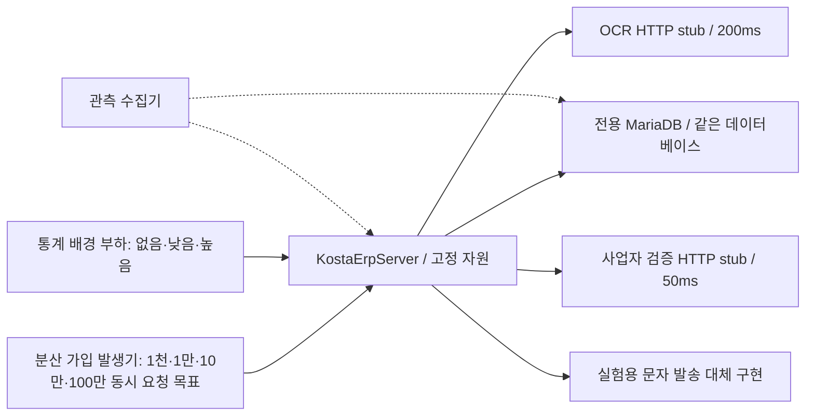

# 통계 조회 부하가 회원가입에 미치는 영향: 실험 설계

작성일: 2026-11-04 KST. 상태: **동시 요청 기준으로 설계 보완 완료. 실행기·관측 보완·부하 실행은 미진행**.

사용자가 확정한 기준은 **동시 요청 1,000 → 10,000 → 100,000 → 1,000,000건**이다. 이번 실험에서는 최종 가입 제출 `POST /api/auth/register`를 동시에 진행하려는 목표 수로 정의한다. 총 가입 횟수나 초당 요청률로 바꾸어 해석하지 않는다. 해당 동시 요청 목표마다 가입 단독과 통계 부하를 함께 주는 조건을 비교한다.

### 부하 단위와 대규모 실행의 공통 조건

| 지표 | 정의 | 규모 해석 예시 |
|---|---|---|
| `N` | 한 run에 예정한 총 가입 여정 수 | 총 100,000건을 설정한 기간 동안 시작 |
| `R` | 매초 새로 시작할 가입 여정 수 | 매초 100,000건의 새 가입을 시작하도록 예약 |
| `C_target` | 동시에 진행하려는 최종 가입 HTTP 요청 수 | 1,000,000개의 가입 제출을 동기화해 시작하려는 목표 |
| `C_client` | 클라이언트에서 HTTP 전송을 시작했으나 종료되지 않은 요청 수 | 연결 확보 전 로컬 대기와 구분해 측정 |
| `C_app` | 서버의 관측 진입점에 들어와 아직 종료되지 않은 HTTP 요청 수 | 실제 애플리케이션이 받아 처리 중인 요청 수 |

`N`, `R`, `C_target`은 같은 값이 아니다. 주 실험은 준비한 요청들을 한 번에 시작하는 동시 유입 실험이며, 단계별 burst 1회에 예정하는 가입 제출 수는 C_target과 같다. 응답 종료 후 같은 번호로 재요청하거나 빈 자리를 새 가입으로 채우지 않는다. 초당 처리량·총 완료 수는 관측 결과다. 설정 VU·접속 시도만 100만인 경우를 실제 100만 동시 HTTP 요청 처리로 보고하지 않는다.

규모별로 동일 자원의 가입 단독과 통계 혼합을 비교한다. 발생기와 stub이 목표를 전달하지 못하면 이를 서버 처리량으로 보고하지 않는다. 분산 발생기가 필요하면 전역 예정 건수·식별자 범위·시각을 조정하고 노드별 전달량을 합산한다. 서비스 프로세스 수·CPU·DB 설정은 조건 사이에서 유지하고 발생기 확대를 제품 개선으로 집계하지 않는다.

요청별 JSON·서류·인증 재료 전체를 메모리에 누적하거나 요청마다 로그를 동기 기록하는 방식을 피한다. 합성 PDF 템플릿은 공유하고 fixture 식별자는 순번으로 생성한다. 응답 검사는 각 요청에서 수행하되 결과는 집계하고, 상세 진단 표본·정확성 대조용 식별자는 스트리밍 저장한다. 100만 고유 가입 fixture와 세션은 서로 섞이지 않아야 한다. 인증 코드 수집기·stub·부하 발생기의 대기·메모리·실제 유입도 필수 관측 대상이다.

실험 질문은 “같은 KostaErpServer에서 통계 화면 조회가 증가할 때, 회원가입의 지연·실패가 증가하는가? 증가한다면 어떤 공유 자원에서 대기하는가?”다.
같은 동시 가입 목표·전송 창·자원에서 통계 부하만 바꾼다. 가입 단독, 통계 단독, 혼합 부하를 비교하고 통계를 중단한 뒤 회복도 확인한다. 실제 동시 요청을 확보하지 못한 단계와 서버가 과부하로 거절한 단계도 서로 구분해 보존한다.
병목이나 개선 효과를 미리 전제하지 않는다.

## 1. 대상과 범위

| 구분 | 내용 |
|---|---|
| 대상 제품 | `KostaErpServer`의 기존 모놀리식 Spring 애플리케이션 |
| 회원가입 | 휴대폰 코드 발급 → 코드 확인 → 서류를 포함한 가입 제출 → 실제 회원·인증 계정 저장 |
| 통계 | 기존 매출·지출·폐기 화면이 사용하는 API 묶음 |
| 핵심 비교 | 같은 동시 가입 목표와 전송 시각에서 통계 조회량에 따른 가입 지연·거절·저장 결과·회복의 변화 |
| 결과 범위 | 고정된 자원의 로컬 격리 환경, 합성 사업장·가입자, 응답 시간을 통제한 외부 검증 |
| 제외 | ErpMSA의 Account/FoodMaterials 등 별도 서비스, 실제 OCR 처리량·정확도, 실제 문자 발송, 외부 사업자 검증 서버의 수용량, 관리자 심사 처리량, 운영 배포 |

이번 산출물은 이 설계 문서 하나다. 제품 소스·설정·의존성·기존 대시보드는 변경하지 않는다. 향후 구현 파일은 ErpMSA의 `performance/` 아래 실험 도구로 두며 새로운 업무 서비스 폴더를 만들지 않는다.

## 2. 현재 코드에서 확인한 사실과 가설

### 확인한 사실

| 사실 | 근거 |
|---|---|
| 가입 API는 `/api/auth/register`, multipart 파트는 JSON `request`와 파일 `document`다. 제출 전 휴대폰 인증 세션을 검사한다. | [AuthRestController.java](../../2026_05_KOSTA/KostaErpServer/src/main/java/com/oopsw/kostaerpserver/advice/restcontroller/AuthRestController.java) |
| 가입 컨트롤러는 업무 상태와 별개로 HTTP 200을 반환한다. `APPROVED`와 `PENDING`이면 휴대폰 인증 정보를 지운다. | 같은 컨트롤러 |
| 서류 검증이 APPROVED면 가입 저장을 호출한다. NEED_REVIEW·RETRY는 서류와 심사 신청 저장 후 PENDING으로 전환될 수 있다. | [RegistrationServiceImpl.java](../../2026_05_KOSTA/KostaErpServer/src/main/java/com/oopsw/kostaerpserver/service/entity/ocr/RegistrationServiceImpl.java) |
| 정상 가입 저장에는 BCrypt 인코딩, MyBatis의 USERINFO 저장, 인증 account 저장이 포함된다. 가입 메서드에 `@Transactional`이 있다. | [LoginServiceImpl.java](../../2026_05_KOSTA/KostaErpServer/src/main/java/com/oopsw/kostaerpserver/service/LoginServiceImpl.java) |
| 휴대폰 코드는 HttpSession에 저장되고 발송 구현은 개발 로그 출력이다. 현재 API가 코드 값을 응답하지는 않는다. | [PhoneVerificationServiceImpl.java](../../2026_05_KOSTA/KostaErpServer/src/main/java/com/oopsw/kostaerpserver/service/PhoneVerificationServiceImpl.java), [DevelopmentPhoneVerificationCodeSender.java](../../2026_05_KOSTA/KostaErpServer/src/main/java/com/oopsw/kostaerpserver/service/DevelopmentPhoneVerificationCodeSender.java) |
| 보안 설정은 STATELESS지만 휴대폰 인증 로직은 HttpSession을 사용한다. 부하 도구도 실제 세션 쿠키를 왕복해야 한다. | [SecurityConfig.java](../../2026_05_KOSTA/KostaErpServer/src/main/java/com/oopsw/kostaerpserver/auth/config/SecurityConfig.java), 위 인증 서비스 |
| 화면 조회 1회에 매출 3개, 지출 3개, 폐기 5개 API를 병렬 호출한다. 월별 차트는 6개월 범위를 사용한다. | [revenueStatistics.js](../../2026_05_KOSTA/KostaErpServer/src/main/resources/static/js/revenueStatistics.js), [usedStatistics.js](../../2026_05_KOSTA/KostaErpServer/src/main/resources/static/js/usedStatistics.js), [disposalStatistics.js](../../2026_05_KOSTA/KostaErpServer/src/main/resources/static/js/disposalStatistics.js) |
| 통계 SQL에는 JOIN·SUM·GROUP BY·정렬·윈도 함수가 있고 기간 조건은 `startDate 이상, endDate 미만`이다. | [statisticsMapper.xml](../../2026_05_KOSTA/KostaErpServer/src/main/resources/mappers/statisticsMapper.xml) |
| Spring Boot 3.5.14, MyBatis starter 3.0.5, JPA·Actuator가 선언되어 있다. Java 컴파일 대상은 17이다. | [pom.xml](../../2026_05_KOSTA/KostaErpServer/pom.xml) |
| 명시적인 별도 통계 DataSource 구성은 발견하지 못했다. Hikari 크기·Tomcat 스레드 수의 명시 설정도 확인되지 않았다. | application.yaml 및 DataSource·TransactionManager 구성 검색 |
| OCR용 RestClient의 요청 팩토리에 명시적인 연결·읽기 타임아웃 설정은 없다. | [ExternalApiClientConfig.java](../../2026_05_KOSTA/KostaErpServer/src/main/java/com/oopsw/kostaerpserver/service/client/ExternalApiClientConfig.java) |

하나의 DataSource·풀을 공유할 가능성이 높지만 **실행 시 JPA와 MyBatis가 참조하는 실제 풀을 확인하기 전에는 확정하지 않는다**. BCrypt 실행 중 DB 연결을 점유하는지도 실제 획득·반납 시점으로 확인한다.

### 검증할 가설

| 가설 | 함께 나타나야 하는 증거 |
|---|---|
| H1. 통계 SQL의 연결 점유가 가입의 DB 연결 획득을 지연시킨다. | 통계 실행·연결 점유 증가, 풀 pending 증가, 가입 흐름의 연결 획득 대기 증가 |
| H2. 통계 부하가 애플리케이션 CPU를 사용해 가입의 BCrypt·처리를 지연시킨다. | 앱 CPU·throttling 증가, BCrypt 구간 증가, DB 연결 대기로 설명되지 않는 가입 지연 |
| H3. 느린 통계 요청이 웹 스레드를 점유해 가입의 처리 시작을 늦춘다. | Tomcat busy·진입 대기 증가, 서버 내부 처리시간보다 클라이언트 지연이 크게 증가 |
| H4. 큰 결과·할당량이 GC를 늘려 두 흐름을 함께 지연시킨다. | GC 정지·할당·메모리 변화가 지연 시점과 일치 |
| H0. 이번 조건에서는 의미 있는 가입 영향이 관측되지 않는다. | 목표 부하를 실제로 전달했고 자원 여유가 있으며 가입 지표가 사전 기준 안에 있음 |

H1~H4는 후보 원인이다. 지연과 CPU가 동시에 증가했다는 사실만으로 원인을 확정하지 않는다.

## 3. 격리 환경과 외부 검증 통제

### 휴대폰 관련 현재 구현과 실험 계획의 구분

현재 있는 것은 서버의 랜덤 6자리 인증번호 생성, 세션 저장·일치/만료 검사, 개발용 로그 출력이다. **실제 SMS 발송 연동은 미구현**이므로 실제 휴대폰 번호 소유를 확인하는 기능이 완성됐다고 표현하지 않는다.

실험에서 제안한 경로는 `서버가 인증번호 생성 → 실험용 발송 대체 구현이 메모리 수집기에 전달 → 부하 도구가 그 값을 받아 같은 세션의 확인 API 호출 → 가입 제출`이다. 전화번호는 합성 데이터이며 실제 휴대폰이나 문자 사업자로 전송하지 않는다. 발송 대체 구현·수집기는 앞으로 구현할 실험 장치이고 현재 실행 가능한 상태가 아니다. 기존 로그를 대량 수집해 인증번호를 읽는 방식으로 설계하지 않는다.

따라서 이 경로의 측정 범위는 **서버 내부 인증번호 검사와 이후 가입 처리**다. 실제 문자 전달 시간·성공률·휴대폰 소유 확인은 검증하지 않는다. 이 실험을 위해 제품에 실제 SMS 기능을 새로 구현하는 작업도 포함하지 않는다.

### 발송 대체 구현의 구체적 명세

실험 코드는 ErpMSA의 `performance/kosta-signup-statistics-lab/` 아래 별도로 두는 안이다. 아래 파일·API는 **구현 예정**이며 현재 존재하거나 호출 가능한 것으로 간주하지 않는다.

| 구성 | 책임 |
|---|---|
| `LoadLabLauncher` / `LoadLabConfiguration` | 원본 앱과 실험 설정을 함께 시작한다. `load-lab` profile에서 `@Primary` 발송 Bean을 주입한다. 실험 클래스는 원본 제품 JAR에 포함하지 않는다. |
| `LabPhoneCodeSender` | 기존 `PhoneVerificationCodeSenderService.send(phone, code)`를 구현한다. 원본 서비스가 생성한 코드를 그대로 mailbox에 넣는다. 전화번호나 인증번호를 새로 생성하거나 문자를 발송하지 않는다. |
| `LabCodeMailbox` | `ConcurrentHashMap`으로 `(runId, phone)`별 코드와 만료시각을 보관한다. 조회는 원자적 remove로 한 번만 허용하고, 최대 5분 TTL·정기 정리·저장 상한을 둔다. 최종 유효성 검사는 원본 서비스가 담당한다. |
| `LabControlServer` | 같은 실험 JVM의 별도 내부 제어 포트에서 코드 1회 조회만 제공한다. 앱의 기존 업무 경로·SecurityFilterChain에 테스트용 공개 경로를 추가하지 않는다. |
| 부하 도구의 인증 준비 단계 | 합성 전화번호·개별 cookie jar를 사용해 코드 발급, 실험 제어 포트 조회, 코드 확인을 순서대로 실행한다. 이후 같은 JSESSIONID로 최종 가입을 제출한다. |

연결점은 이미 있는 `PhoneVerificationCodeSenderService`다. 설정의 핵심은 다음과 같다. 코드는 구조 설명용이며 아직 실행 코드에 추가하지 않았다.

```java
@Bean
@Profile("load-lab")
@Primary
PhoneVerificationCodeSenderService labPhoneSender(LabCodeMailbox mailbox) {
    return (phone, code) -> mailbox.put(phone, code);
}
```

구체적인 요청 순서는 다음과 같다.

1. 앱 `POST /api/auth/phone/code`에 합성 phone을 보낸다. 원본 서비스가 랜덤 6자리 코드를 생성해 HttpSession에 저장하고 `send(phone, code)`를 호출한다. 실험 Sender가 같은 코드를 mailbox에 보관한다.
2. 준비 도구가 제어 포트의 `POST /codes/take`에 phone을 보낸다. 실험 실행별 임시 `X-Lab-Key`를 확인한 뒤 코드 1개를 반환하고 삭제한다. 코드가 없거나 만료됐으면 404, 제어 키가 틀리면 401로 처리한다. 응답은 캐시하지 않는다.
3. 앱 `POST /api/auth/phone/verify`에 받은 phone·code를 보내되 1번의 쿠키를 유지한다. 원본의 일치·만료·시도 횟수 검사를 통과해야 인증 준비 완료로 센다.
4. 해당 세션으로 `POST /api/auth/register`를 호출한다. 주 burst에서는 이 4번만 동시에 시작한다. 1~3번의 시간·실패·코드 운반 부하는 준비 지표로 분리한다.

동일 phone을 여러 가상 가입자에게 재사용하지 않는다. 제어 포트는 실험 내부망에만 연결하고, 키·코드·세션 쿠키를 결과 로그에 남기지 않는다. mailbox는 준비 중인 코드만 보관하며 소비한 코드는 바로 제거한다. 100만 가입자 수만큼 코드를 끝까지 누적하지 않는다. 제어 응답 유실·만료·저장 상한 초과는 인증 준비 실패로 기록하며 임의 인증 성공으로 바꾸지 않는다.

구현 검증은 Sender가 받은 코드의 동일성·1회 소비·만료·제어 키 검사, 원본 API와의 세션 왕복, 잘못된 코드·다른 세션 거절을 포함한다. 코드 조회 장치의 처리량·메모리도 별도로 측정하고 원본 서버의 가입 처리량과 구분한다. 현재 이 구현·검증은 모두 미진행이다.



OCR·사업자 검증 서버는 **네트워크 HTTP 경계에서만** 대체한다. 원래의 서류 검증·가입·DAO·트랜잭션·BCrypt를 실행한다. 검증 서비스 자체를 항상 승인하는 Mock으로 바꾸지 않는다.

- OCR stub은 파일명의 fixture 식별자에 대응하는 사업자번호·개업일자·이름을 반환하고, 본문이 미리 만든 합성 PDF 템플릿 해시와 일치하는지 확인한다. 모든 가입자에게 같은 번호를 반환하면 안 된다.
- OCR 응답은 `PythonOcrResponse` 계약, 사업자 검증 응답은 `status_code=OK`, 해당 `b_no`, `valid=01` 계약을 따른다.
- 고정 응답 지연은 각각 **200ms·50ms**다. 실제 OCR 지연의 측정값이 아닌 통제 조건이다. 모든 주 실험의 예상 가입 결과는 APPROVED로 통일한다.
- 스텁의 실제 처리시간·대기열·오류를 기록한다. 고정 sleep 외 추가 처리시간 p95가 20ms를 넘는 등 스텁 자체가 밀리면 외부 조건 통제 실패로 표시하고 원인을 제거한 뒤 반복한다.
- 서류는 실행 전에 생성한 100KiB 합성 PDF 템플릿을 사용한다. 요청별 파일명에 실험 fixture 식별자를 넣고 stub이 가입자 매핑을 검증한다. 높은 가입률에서 가입자 수만큼 파일을 메모리에 복제하지 않고 템플릿을 재사용한다. 실제 문서·개인정보를 쓰지 않는다. 이 조건은 큰 파일 업로드나 PENDING 서류 영속 저장의 처리량을 검증하지 않는다.
- 별도의 lab 런처에서 기존 발송 인터페이스에 `@Primary` 실험 구현을 주입한다. 생성된 코드는 격리된 메모리 수집기로 전달하고 부하 도구가 일회성 조회한다. 코드 생성·세션 확인·만료 검사는 원본 로직을 유지한다.
- 위 문자 대체 구현과 수집기는 **구현해야 할 실험 장치**다. 고정 OTP, 인증 세션 우회, 운영 API에 테스트용 조회 경로 추가는 설계에 포함하지 않는다. OTP·토큰·비밀번호를 로그나 결과 파일에 기록하지 않는다.

실험 Compose 프로젝트 이름은 `kosta-signup-statistics-lab-<runId>`처럼 실행별로 고유하게 한다. 현재 ErpMSA Compose·운영 `.env`·기존 DB·기존 볼륨은 사용하지 않는다. DB·업로드 임시 디렉터리·실험 키는 새로 만들고 localhost 또는 실험 내부 네트워크에만 연결한다. 두 외부 URL이 허용한 stub 주소인지 검사하고, 실제 외부 서비스로 향하면 시작을 거절한다.

앱·DB의 CPU·메모리·접속 상한은 실험 환경 ID마다 고정한다. 기존의 앱 2 vCPU/1GiB·발생기 1대 예산을 100만 동시 요청을 달성할 구성이라고 간주하지 않는다. 발생기는 분산 구성을 기본으로 설계하고, 실제 노드당 HTTP 동시 전송·네트워크·메모리·파일 디스크립터·송신 IP/포트 한계를 검증한 뒤 노드 수를 산정한다. 제품 자원을 늘리는 후속 실험은 별도 환경 ID로 분리한다.

100KiB 서류를 100만 번 제출할 때 파일 본문만 **102.4GB(약 95.37GiB)**가 전송된다. 이 값은 한 burst의 총 payload이며 초당 전송량이 아니다. 이를 1초 창에서 전송 시작하도록 하는 데 필요한 네트워크와 실제 업로드 완료시간을 따로 측정한다. 데이터 전송이 시작됐다는 이유로 파일 전체가 서버에 도착했다고 간주하지 않는다.

DB는 신규 회원·인증 계정이 최대 각각 100만 행 증가하는 경우와 세션 메모리·업로드 임시 저장을 수용하도록 사전 산정한다. 실험 전용 DB 저장소를 사용하며 작은 tmpfs가 자동으로 충분하다고 가정하지 않는다. 발생기·DB·업로드 저장소가 부족하면 해당 장치의 한계로 표시한다. 실제 자원 확보·외부 서버 생성·유료 사용은 이번 설계 작업에서 수행하지 않는다.

실제 Hikari maximum/minimum·connectionTimeout, Tomcat maxThreads·acceptCount, JDK·DB 버전/이미지 digest, DB buffer pool·실행 스키마를 manifest에 저장한다. 현재 미지정 값을 문서에서 임의로 “운영 설정”이라 부르지 않는다. 첫 비교에서는 풀 크기·스레드 수·인덱스를 조절하지 않는다.

동일 호스트에서는 stub·발생기와 앱이 물리 CPU를 공유한다. 발생기·stub 포화 또는 호스트 swap이 발견되면 그 조건을 분리해서 다시 측정해야 한다. 이 실험만으로 운영 서버나 여러 호스트의 수용량을 추정하지 않는다.

## 4. 데이터와 요청 계약

### 데이터

| 항목 | 첫 데이터셋 D1 |
|---|---|
| 기존 통계 사업장 | 12개, 균등한 데이터량 |
| 기간 | 2025-11-01 이상 ~ 2026-11-01 미만, 12개월 |
| purchase | 사업장당 10,000행, 총 120,000행 |
| DISPOSALS | 사업장당 10,000행, 총 120,000행 |
| SALES | 사업장당 20,000행, 총 240,000행 |
| 참조 데이터 | 사업장당 메뉴 50개·식자재 100개, 유효한 카테고리·매출·폐기사유 참조 |
| 신규 가입자 | 기존 사업장과 겹치지 않는 번호·전화·이메일, warmup/본측정/회복 구간도 서로 분리 |

신규 가입자 fixture 개수와 식별자 범위는 `각 burst의 C_target`에 warmup·회복·진단용 가입자를 더해 사전 계산한다. 노드별 식별자 구간을 분할해 서로 겹치지 않게 한다. fixture 고갈·번호 반복·대량 파일 로딩이 발생기 병목이 되지 않게 한다. 가입 여정 1회에는 앱으로 향하는 HTTP 요청이 최소 3건, 두 검증 stub으로 향하는 호출이 정상 경로에서 2건 포함된다. 주 동시성 지표에서는 최종 가입 제출 요청만 센다.

날짜·금액·수량은 고정 seed로 생성하고 정답 집계를 함께 만든다. 사업장마다 결과를 구별할 수 있게 해 타사업장 결과 혼입을 검사한다. 실제 운영 비율이나 데이터량이라고 주장하지 않는다. D1에서 부하가 너무 약하면 별도 D2(행 수 10배)를 만들고 D1과 섞지 않은 전체 비교를 수행한다.

기존 [kosta-statistics.sql](../scripts/fixtures/kosta-statistics.sql)과 [kosta-account.sql](../scripts/fixtures/kosta-account.sql)은 기능 검증용 최소 스키마다. 그대로 행 수만 늘린 것을 운영 성능 재현으로 취급하지 않는다. 본 비교 전 실제 프로젝트의 스키마 정의와 PK·인덱스·제약조건을 대조한 **데이터 없는 스키마 사본**을 확보한다. 확보되지 않으면 최소 스키마 실험은 `synthetic_schema_exploratory`로만 기록하고, 실제 구성에서의 영향 검증은 미확인으로 남긴다. 이 설계 과정에서 실제 DB에 접속하거나 데이터를 추출하지 않았다.

매 run은 동일한 초기 스키마·데이터 checksum에서 시작한다. 부하 중에는 seed·대량 INSERT·인덱스 변경·빌드·백업을 실행하지 않는다. 가입으로 늘어난 데이터는 다음 run에 넘기지 않는다.

### 가입 iteration 1회

1. runId·scenario·전체 iteration 번호로 유일한 합성 가입자를 선택한다. VU 번호만 사용해 ID가 반복되지 않게 한다.
2. 새로운 cookie jar로 `POST /api/auth/phone/code`에 `{"phone":"<합성 번호>"}`를 보낸다. `JSESSIONID`를 유지한다.
3. 실험용 발송 수집기에서 해당 코드 1개를 얻는다. 이 조회시간은 따로 측정한다.
4. 같은 세션으로 `POST /api/auth/phone/verify`에 phone·code를 보내 `success=true`를 확인한다.
5. 같은 세션으로 `POST /api/auth/register`에 JSON `request`와 PDF `document`를 보낸다. JSON 파트의 Content-Type도 `application/json`으로 지정한다.
6. HTTP 상태, 업무 `status`, 클라이언트 지연을 기록한다. 세션·코드는 다음 iteration에 재사용하지 않는다. 자동 가입 재전송은 하지 않는다.

`auth_prepare_ms`는 코드 발급부터 코드 확인까지이며 수집기 조회시간을 별도 첨부한다. `signup_submit_ms`는 최종 multipart 요청 호출부터 응답까지이며 연결 대기·업로드·응답 대기를 함께 분해한다. 동시 제출을 위한 READY 대기와 barrier 대기는 가입 응답 지연에 더하지 않는다. 휴대폰 단계 실패는 준비 단계 실패로 집계하고 C_target개의 인증 준비를 못 마친 경우를 주 동시 제출 실험의 실행 성공으로 보고하지 않는다. 전체 여정 시간은 작은 smoke·별도 진단에서만 다룬다.

### 통계 iteration 1회 = 화면 API 묶음 1회

| 화면 | 동시에 호출할 경로 (`/api/statistics` 기준) | 기간 |
|---|---|---|
| 매출 | `/revenue/total`, `/revenue/menu-rank`, `/revenue/monthly` | total·rank는 선택 월, monthly는 해당 월까지 6개월 |
| 지출 | `/expenses/total`, `/expenses/material-rank`, `/expenses/monthly` | total·rank는 선택 월, monthly는 해당 월까지 6개월 |
| 폐기 | `/disposals/rate`, `/disposals/total-price`, `/disposals/top-materials`, `/disposals/reason-ratio`, `/disposals/daily-chart` | 선택 월 |

세 화면을 1:1:1로 호출한다. 한 순환을 화면 3종 × 사업장 12개 × 선택 월 6개(2026-05~10)로 구성해 특정 화면·사업장의 상관 편중을 피한다. 조회 시작/종료일을 문자열로 고정하고 종료일은 다음 달 1일로 지정한다.

화면 조회 2회/초는 평균 **약 7.33 HTTP 요청/초**, 10회/초는 **약 36.67 HTTP 요청/초**다. 비율은 실제 전달 건수로 다시 계산한다. 각 묶음은 `http.batch()`로 병렬 전송하고 호스트당 batch 동시 호출 제한을 최소 5로 둔다. 묶음 시작부터 마지막 응답까지를 `statistics_bundle_ms`로 측정한다. DOM·차트 렌더링 시간은 포함하지 않는다.

`/revenue/history`와 `/expenses/material-rank/chart`는 현재 세 화면의 위 호출 묶음에 없으므로 첫 실험에서 제외한다. 통계용 JWT는 기존 12개 합성 사업장의 subject·ROLE_USER와 임시 실험 키로 사전 마련한다. 유효기간이 run 전체를 덮는지 확인하고, 측정 도중 로그인·토큰 재발급 부하를 섞지 않는다. 기존 키나 토큰은 사용하지 않는다.

## 5. 동시 요청 단계와 실행 방식

### 사전 검증과 분산 발생기

부하 없는 smoke에서 가입 5건과 모든 화면·사업장·월 조합을 검증한다. 두 계정 테이블 저장, 휴대폰 세션 왕복, 통계 정답·사업장 경계, 실제 DataSource 공유, 필수 관측을 확인한다.

발생기는 여러 노드로 분산하고 각 노드에 고유 가입자 구간을 배정한다. 조정기는 전역 runId·단계·시작 시각·예정 수를 배포하고 READY 응답을 모은다. 노드별 시각 오차는 사전 점검하고 10ms를 넘으면 1초 전송 창 비교를 시작하지 않는다. 대상 앱과 DB의 자원·인스턴스 수는 전 조건에서 유지한다. [k6 대규모 부하 실행 안내](https://grafana.com/docs/k6/latest/testing-guides/running-large-tests/)

별도의 비업무 수신기로 노드당 실제 동시 HTTP 전송, 파일 업로드, CPU/RSS·FD·포트·네트워크 한계를 먼저 측정한다. 이 수신기는 발생기 검증에만 쓰며 제품 성능으로 보고하지 않는다. 노드당 검증한 여유 있는 동시 요청 한도를 g_safe라 하면 노드 수의 초기 산정은 `ceil(C_target / g_safe)`다. 예를 들어 g_safe가 실측으로 10,000일 때 100만 목표에는 최소 100노드가 필요하다는 산정이지만, **현재 측정된 값이나 확보된 노드 수는 아니다**. 공유 네트워크·송신 IP·수신측 한계까지 점검해야 최종 규모를 확정할 수 있다.

k6를 사용할 경우 가입 제출은 준비한 세션당 HTTP 요청 하나를 실행하는 `per-vu-iterations` 계열의 동기화된 단발 실행으로 구성한다. 단순히 VU를 설정하거나 일정 시간 iteration을 반복하는 것만으로 목표 동시 HTTP 요청을 달성했다고 판정하지 않는다. 요청별 연결 대기·전송 시작·본문 전송·응답 완료 시각은 HTTP 계측 또는 발생기 확장으로 확보해야 한다. [k6 실행기 구분](https://grafana.com/docs/k6/latest/using-k6/scenarios/executors/)

### 휴대폰 인증 준비는 별도 구간

원본 코드의 인증번호 유효기간은 5분, 인증 완료 후 가입 제출 가능 시간은 10분이다. 각 가입자에 대해 원본 코드 발급·확인 API를 호출하고 세션 쿠키를 준비한다. 인증 준비 전체는 최초 인증 완료 후 6분 이내를 목표로 하며, 이후 통계 warmup 2분을 거쳐 제출 시점에도 모든 세션의 인증 유효기간이 최소 2분 남았는지 검사한다.

해당 단계의 C_target개 유효 세션을 준비할 수 없으면 `PRECONDITION_LIMIT`로 기록한다. 인증 준비량·세션 메모리·준비 단계 실패와 시간을 별도 보고한다. 원래의 인증 시간을 늘리거나 인증을 생략해 같은 실험이 성공한 것처럼 만들지 않는다. 전송 시점에는 유효했으나 서버 대기로 뒤늦게 만료된 경우는 별도 오류 원인으로 추적한다.

### 본측정 조건: 4개 동시 요청 목표 × 통계 3조건

| 단계 | 동시 가입 제출 목표 C_target | A | B | C |
|---|---:|---|---|---|
| C1 | 1,000 | 통계 없음 | 낮은 통계 부하 L_low | 높은 통계 부하 L_high |
| C2 | 10,000 | 통계 없음 | L_low | L_high |
| C3 | 100,000 | 통계 없음 | L_low | L_high |
| C4 | 1,000,000 | 통계 없음 | L_low | L_high |

L_low·L_high는 원래 통계 화면 API 묶음을 지속 호출하는 두 고정 유입률이다. 통계 단독의 정답·지연·실제 전달량·자원 점유를 예비 측정해 확정하고, 모든 C단계에서 같은 값을 사용한다. 통계만으로 이미 장애 상태인 조건은 별도의 통계 과부하 조건으로 표시한다. 통계율을 가입 동시 요청 목표와 혼동하지 않는다.

각 조건을 3회 반복한다. 총 12개 조건·36회 주 burst이며, 동일 C_target 안에서 A/B/C 순서를 고정 seed로 섞는다. C1~C4는 독립된 환경·데이터에서 진행하고 앞 단계의 대기 요청·새 계정이 다음 단계로 넘어가지 않게 한다. 통계 단독 대조 실행도 두 L값에 각각 마련한다. 100만까지 모두 완료된다고 전제한 실행시간이나 자원 비용은 아직 산정하지 않는다.

한 run의 진행은 다음과 같다.

1. 동일 초기 스키마·데이터·제품 자원에서 필수 지표와 프로세스를 확인한다. 부하 없는 작은 공통 warmup을 수행하고 종료한다.
2. C_target명의 유효한 인증 세션과 합성 요청을 준비한다. 상태를 READY로 모으고 부족하면 주 burst를 시작하지 않는다.
3. B/C는 정해진 통계 부하를 2분 먼저 넣어 유지한다. A도 같은 시간 대기한다. 인증 준비 실패와 통계 준비 실패를 섞지 않고 각각 기록한다.
4. 전역 T0에 가입 제출을 해제한다. 각 노드는 배정된 요청을 **1초 이내에 HTTP 전송 시작**하도록 시도한다. 실제 시작 시각 분포·연결 확보 전 대기·전체 전송 창을 보존한다. 파일 전체가 1초 안에 업로드되었다고 가정하지 않는다.
5. 제출 요청은 최대 60초 응답을 기다린다. 응답한 요청을 다른 가입으로 보충하거나 자동 재전송하지 않는다. 따라서 고정 동시 수를 10분 유지하는 반복 실험과 구별된다.
6. T0+60초에 통계를 중단하고 최대 120초 추가 drain에서 잔여 요청·뒤늦은 커밋을 추적한다. client timeout은 서버 작업 취소나 실패 확정과 같지 않다.
7. 통계 중단 후 1·2·3분 시점에 각각 별도 가입자 1,000명의 동시 제출 probe로 회복을 비교한다. 이 probe의 인증은 사용 직전에 준비하고, 준비가 실패한 것도 회복 미확인 근거로 기록한다. 주 burst·인증 준비·회복 probe의 건수와 지연을 분리한다.
8. 이후에도 남은 서버 작업을 확인하고, 신규 ID 전체 저장 결과를 읽기 전용으로 대조한 뒤 실험 소유 자원만 정리한다. 정리까지의 실제 시간을 기록한다.

60초 응답 상한과 1초 전송 창은 사전 실험 조건이다. 단계 사이에서 유리하게 바꾸지 않는다. 외부 stub은 계속 200ms·50ms이며, 이 응답시간은 서버의 대량 가입 처리를 보장하지 않는다.

### 동시 요청의 실제 달성 판정

설정된 C_target 외에 다음 시계열과 peak를 함께 남긴다.

- 준비된 세션 수, 요청 해제 수, 연결 대기 수, 전송 시작 수, 본문 전송 완료 수, 응답/오류/timeout 수.
- C_client: 연결 확보 후 HTTP 전송을 시작해 아직 종료되지 않은 요청의 실제 중첩. HTTP 요청 전체 호출시간에 포함된 로컬 연결 대기는 별도 계산한다.
- C_app: lab 관측 filter 진입부터 종료까지의 실제 중첩. 커널/Tomcat 수신 큐에서 기다리는 연결은 C_app에 포함하지 않는다. 가능하면 TCP 연결·accept 큐도 별도 수집한다.
- 전송 창 동안 목표의 95% 이상에 해당하는 C_client가 100ms 이상 실제로 겹쳤는지와, 정확한 peak·지속시간. C_app도 원값을 보고하며 목표 수를 대신 채워 넣지 않는다.

동시 전송을 충분히 만들지 못한 경우 발생기 포화·망 병목·서버 접속 제한·빠른 거절을 구분한다. 실제 중첩 수가 목표에 못 미쳤다면 “100만 동시 처리 검증”으로 표기하지 않고 목표 미달과 원인을 보고한다. 서버가 빠르게 거절한 결과는 발생기 한계와 다르며 과부하 방어 결과로 보존한다.

같은 C_target에서도 A/B/C의 실제 도달 수가 크게 다르면, 예정 동시 유입에 대한 수용·거절 결과로 비교하고 동일한 실제 처리 동시성에서의 p95 차이라고 해석하지 않는다. 조건을 맞춘 후속 진단으로 원인을 확인한다. 목표 단계는 그대로 남기며 관측할 수 없었던 큰 단계를 낮은 수치로 바꾸어 완료 처리하지 않는다.

## 6. 측정 지표와 관측 준비

| 계층 | 필수 지표 | 용도 |
|---|---|---|
| 부하 전달 | C_target·C_client·C_app peak/지속시간, 전송 시각 분포·본문 완료·응답·미시작 수, 실제 요청률, 발생기 자원 | 목표 동시 부하가 도달했는지 확인 |
| 가입 여정 | 인증 준비 성공/실패, 최종 제출 수, APPROVED/PENDING/REJECTED/RETRY 수, 전송 오류·timeout | 준비와 제출 실패를 분리 |
| 가입 지연 | `auth_prepare_ms`, `signup_submit_ms`의 p50·p95·p99, 연결·업로드·응답 대기, 결과별 표본 수 | 사용자 관점 영향과 발생기 대기 구분 |
| 통계 | API별 p50·p95·오류·결과 검증, `statistics_bundle_ms`·묶음 실패율, 응답 bytes | 실제 통계 부하·결과 크기 |
| DB 풀 | active/idle/max/pending, acquire/usage 시간·timeout, 가입 흐름의 `getConnection()` 대기 | 연결 점유·획득 병목 |
| DB | CPU·메모리·실행 스레드·쿼리 시간·읽은 행·임시 테이블·잠금 대기 | 풀 대기와 DB 내부 병목 구분 |
| 웹/JVM | Tomcat busy/max·가능한 진입 대기, CPU/throttling·RSS·heap·GC 정지 | 스레드·CPU·메모리 원인 확인 |
| 외부 통제 | stub별 실제 처리시간·queue·오류, 앱의 HTTP client 시간, OTP 수집기 지연 | 외부 검증·실험 장치의 흔들림 구분 |
| 데이터 | 신규 ID별 USERINFO/account 개수·누락·고아 행·예상 밖 심사 신청 | 응답과 저장 결과 대조 |

자원 지표는 기본 2초 간격으로 수집하되, 동시 요청 중첩은 요청별 시작·종료 이벤트로 재구성한다. 2초 scrape의 gauge만으로 짧은 동시 peak를 증명하지 않는다. 노드별 시각 오차와 계측 정밀도를 같이 기록한다. run 전체와 결과별 p50·p95·p99를 제시하고 timeout 표본은 실제 완료시간이 알려지지 않은 것으로 표시한다. 거절 응답이 빨라 p95가 낮아진 경우를 성공 가입의 성능 개선으로 해석하지 않는다. 작은 회복 probe와 큰 주 burst의 분위수를 합치지 않는다.

현재 Actuator 의존성은 있으나 이 실험용 지표 수집 경로·접근·단계별 계측이 준비됐다는 뜻은 아니다. 다음은 실행 전에 마련한다.

1. 실험 설정에서 `health,metrics`만 노출하고 통계와 별도의 관측용 임시 JWT로 JSON metrics를 수집한다. Prometheus registry가 있다고 가정하거나 의존성을 먼저 추가하지 않는다. 기존 보안 필터로 접근되는지 smoke에서 확인한다.
2. 실제 `jdbc.connections.*`, `hikaricp.*`, `http.server.requests`, `http.client.requests`, JVM 지표 이름·태그를 열거해 manifest에 저장한다. Tomcat 지표는 실험 설정에서 `server.tomcat.mbeanregistry.enabled=true`로 활성화한다. [Spring Boot 3.5 지표 문서](https://docs.spring.io/spring-boot/3.5/reference/actuator/metrics.html)
3. lab 전용 관측 훅으로 검증 HTTP 호출, BCrypt encode, 가입 저장·커밋, 연결 획득 구간을 기록한다. 원래 메서드·반환값·트랜잭션 경계를 유지하며 flow별 JDBC 대기는 동일 Hikari에 위임하는 관측 래퍼로 구분한다. 이 계측은 아직 구현되어 있지 않다. 중첩 구간의 p95를 더해 전체 p95로 만들지 않는다.
4. 스레드 스냅샷/JFR은 필요한 진단 반복에서 수집하고, 본 비교의 계측 설정은 모든 조건에서 동일하게 둔다. 필수 단계/풀 지표가 없으면 영향 관찰과 원인 확인의 완료 상태를 나눈다.
5. 동일 수집 빈도의 부하 없는 실행으로 관측 자체의 부하를 확인한다. metrics 요청은 업무 요청 집계에서 제외한다. 수집 실패 구간을 0으로 채우지 않는다.

SQL 실행계획은 본 부하와 **분리된 진단 run**에서 같은 데이터·파라미터로 수집한다. `EXPLAIN FORMAT=JSON`과 `ANALYZE FORMAT=JSON`의 실제 읽은 행·시간을 비교하되, 후자는 쿼리를 실제 실행하므로 측정 중 추가 호출하지 않는다. [MariaDB 공식 설명](https://mariadb.com/docs/server/reference/sql-statements/administrative-sql-statements/analyze-and-explain-statements/analyze-format-json)

## 7. 정확성·비교 가능성·중단 기준

### 가입 성공 판정

주 실험의 성공은 **HTTP 200 + 업무 status=APPROVED + 해당 ID의 USERINFO/account가 각각 정확히 1개**인 경우다. 주 실험에서 PENDING은 가입 완료로 세지 않는다. HTTP 200이어도 RETRY·REJECTED면 실패이며 상태별로 분리한다.

예정 수 → 인증 준비 → 요청 해제 → 연결/전송 → 본문 도착 → 응답 → DB 저장을 연결한다. 전송 달성률은 전송 시작 수/C_target, 제출 성공률은 제한시간 내 정상 승인·저장 수/전송 시작 수, 목표 대비 성공률은 제한시간 내 정상 승인·저장 수/C_target으로 나누어 보고한다. 완료 응답만을 분모로 삼지 않는다. 준비 실패로 주 burst를 실행하지 못했다면 제출 성공률은 미측정으로 표시한다. 저장 여부는 부하·회복·drain 뒤 신규 ID 전체를 읽기 전용으로 대조해 측정 중 조회 부하를 추가하지 않는다.

timeout인데 DB에 회원이 생긴 경우는 `client_timeout_committed`로 별도 기록한다. 응답은 APPROVED인데 저장이 누락되거나 한 테이블만 남으면 정확성 실패다. 통계 응답도 HTTP 200만 확인하지 않고 생성기의 정답·사업장 경계와 대조한다. 서버 응답 하나를 정답으로 복제해서 다른 서버 응답을 검증하지 않는다.

### 영향 판정: 사전에 고정할 연구 기준

각 블록에서 같은 C_target과 전송 창의 A/B/C를 비교한다. 실제 도달 동시성·전송 달성률도 먼저 확인한다.

`가입 지연 배율 R95(C_target,L) = 혼합(C_target,L)의 signup_submit p95 / 같은 블록 단독(C_target)의 signup_submit p95`

- **지연 영향 관측**: 3개 블록 중 2개 이상에서 R95 ≥ 1.20이고 절대 증가가 100ms 이상이며, 나머지 블록도 R95 ≥ 1.00인 경우. 배율·원래 p95·표본 수를 모두 제시한다.
- **신뢰성 영향 관측**: 같은 C_target의 A와 비교해 timeout·거절·정상 승인·저장 불일치가 어떻게 변하는지 보고한다. 정상 승인률 99% 미만은 실험상 신뢰성 경보로 표시한다. 외부 stub·발생기 실패가 원인이면 제품 영향과 구분한다. A부터 심한 과부하라면 해당 단계는 수용·거절·복구 한계를 비교하는 결과로 남기며, 성공 가입 p95만으로 통계의 추가 영향을 확정하지 않는다.
- **이번 조건에서 영향 기준 미충족**: 목표 부하 전달·정확성 검사를 통과했으나 위 기준에 미달한 경우. “통계는 회원가입에 영향을 주지 않는다” 또는 “운영에서도 안전하다”로 확대하지 않는다.
- 같은 C_target의 A 3회 p95 최대/최소가 1.10을 넘으면 기준 환경 변동·실제 전송 차이를 먼저 조사한다. 서로 다른 동시 요청 목표의 A를 섞어서 비교하지 않는다. 거절·timeout이 지배적인 조건에서는 처리 분포가 달라졌음을 먼저 설명한다. 위 수치는 운영 SLO나 통계적 유의성 검정이 아닌 사전 경보 기준이다. 판정 기준에 못 미친 변화도 원자료에서 숨기지 않는다.

완전한 동시 목표 비교에는 인증 준비·전송 창·C_client 실제 중첩의 검증과 필수 관측, 안정된 stub, 발생기 여유가 필요하다. `dropped_iterations`가 발생하면 미시작 iteration·발생기 설정과 서버 지연을 구분한다. 통계의 arrival-rate scenario에서도 목표·실제 유입을 별도 기록한다. 서버 포화·빠른 거절·접속 제한으로 목표에 도달하지 못한 결과도 보존하되 설정 동시 수나 명목 rate를 실제 처리량으로 쓰지 않는다. [k6의 drop 해석](https://grafana.com/docs/k6/latest/using-k6/scenarios/concepts/dropped-iterations/)

예상 밖 401/403·세션 누락은 인증 장치 오류인지 서버 부하의 결과인지 먼저 진단한다. 토큰 만료·fixture 중복·파라미터 오류면 run을 비교 부적합으로 표시한다. 발생기 CPU가 할당량의 80% 이상으로 30초 지속되거나 throttling으로 전달량이 줄면 발생기 측정 한계로 분리한다.

예상 밖 외부 주소/DB/볼륨 접근, 실험 호스트의 자원 고갈, OOM·DB 종료, 데이터 불일치가 있으면 부하를 중지하고 증거를 보존한다. 격리 대상 서버의 거절·timeout 자체는 관측할 과부하 결과이며 숨기지 않는다. 중단·자원 미확보로 상위 단계에 진입하지 못하면 계획된 단계와 미실행 이유를 남긴다. 실패를 없애려고 같은 run 안에서 설정을 바꾸거나 자동 재가입하지 않는다.

회복 시각은 통계 중단 시점부터 센다. 중단 후 1·2·3분의 동일한 1,000명 가입 probe를 같은 C_target의 A에서 수행한 회복 probe와 비교한다. 풀 pending·진행 중 작업이 줄고, 마지막 두 probe의 정상 승인률이 각각 99% 이상이며 p95가 대응 A probe의 1.20배 이내이면서 절대 차이 100ms 이내인지 본다. 인증 준비 실패나 남은 대기가 있으면 함께 표시한다. 3분 안에 확인하지 못하면 “3분 내 회복 미확인”으로 기록하고 잔여 요청을 추적한다.

## 8. 원인 확인과 후속 개선의 분기

| 관측 | 먼저 확인할 것 | 확인된 뒤 별도 비교할 후보 |
|---|---|---|
| 풀 pending과 가입 연결 획득 대기가 함께 증가 | SQL 시간·연결 점유·트랜잭션 경계·DB CPU | 해당 통계 쿼리/복합 인덱스 개선 |
| DB CPU·실행시간 증가, 연결도 오래 점유 | JOIN·필터 선택도·읽은 행·정렬·임시 테이블 | 실행계획 근거가 있는 SQL 개선 |
| 앱 CPU·BCrypt 구간 증가, DB 대기는 작음 | CPU profile·throttling·GC·다른 프로세스 간섭 | CPU를 많이 쓰는 통계 결과 처리 개선 또는 요청량 제어 |
| Tomcat busy 증가, 내부 가입 처리보다 외부 지연이 크게 증가 | thread dump·접속/요청 진입 대기·진행 중 통계 수 | 통계 동시 실행 제한 등 자원 보호 |
| stub 처리 대기나 OTP 수집기만 증가 | 실험 장치의 자원·동시 처리·network | 실험 장치 수정 후 동일 조건 재측정 |
| 영향이 없고 모든 자원에 여유 | 실제 전달량·데이터 크기·실행계획 | D2 또는 높은 부하를 새 조건으로 추가 |

풀 크기 증설·Redis 캐시·서비스 분리를 기본 처방으로 정하지 않는다. 공유 풀이 포화됐어도 DB 자체가 이미 한계라면 연결 수 증설이 해결책이라고 단정할 수 없다. 개선을 진행할 때는 한 번에 변수 하나만 바꾸고 같은 C_target의 A/B/C를 재측정한다. 원래의 전송 창·통계율·발생기 배치·제품 자원을 유지한다. 제품 자원이나 접속 상한까지 변경한 경우는 별도 환경 비교로 구분한다. 데이터·부하·자원 변경 효과와 제품 코드 개선 효과를 섞지 않는다.

## 9. 결과물과 완료 조건

결과는 `.verification/kosta-signup-statistics/<experimentId>/<condition>/<repeat>/`에 저장하는 안으로 한다. 실제 생성은 구현 단계에서 수행한다.

| 파일 | 내용 |
|---|---|
| `manifest.json` | 제품·실행기·계측 해시, 분산 노드·g_safe·시각 오차·식별자 분할, C_target·전송 창, 통계율, 스키마/데이터 checksum, 버전·자원·접속 상한·timeout |
| `load-summary.json` / `load-samples.jsonl` | 준비·해제·연결·전송·본문 완료·응답/오류, C_client·C_app peak/중첩 시간, 목표 미달 사유, HTTP·업무 결과·지연 |
| `resources.jsonl` | 시각별 JVM·풀·Tomcat·DB·발생기·stub 지표와 수집 누락 |
| `integrity.json` | 가입 ID별 두 테이블 대조, 응답불명 후 커밋, 통계 정답/사업장 경계 검사 |
| `diagnostics/` | 별도 진단 run의 SQL plan·스레드/JFR 등 필요한 증거 |
| `summary.md` | A 대비 가입 지연 배율·원값·오류·실제 처리량·반복별 결과, 원인 근거, 한계, 정리 결과 |

metric 태그에는 flow·route·condition·phase만 사용하고 사업자번호/phone/token/문서명 같은 고유 식별자를 넣지 않는다. 행 단위 대조에는 합성 fixture 식별자만 쓰고 비밀번호·OTP·JWT·문서 본문은 저장하지 않는다. 실패 run도 지우지 않는다. 정리는 실행 ID·Compose label·소유 경로를 확인한 자원만 대상으로 하며 기존 볼륨은 건드리지 않는다.

설계 완료와 실행 완료를 구분한다. 실행 단계의 완료 조건은 다음과 같다.

1. 실제 schema/풀 공유·세션·stub·관측 준비와 분산 발생기 g_safe·시각 동기화·인증 준비를 확인하고 동결된 조건표·manifest를 남긴다.
2. 동시 1,000/10,000/100,000/1,000,000 목표의 A/B/C를 각각 3회 수행하고 실제 전송·중첩·정확성·자원 지표를 확보한다. 미달·준비 한계·미실행도 사유와 함께 남긴다. 목표 단계의 계획 존재와 실제 실행 완료를 구분하며, 미실행 단계가 남으면 전체 실행 완료로 표시하지 않는다.
3. 각 블록에서 같은 동시 목표의 A 대비 B/C의 수용·거절·지연·저장 결과·회복을 보고한다. 실제 도달 동시성도 함께 제시하며 관측한 조건 범위로 결론을 제한한다.
4. 영향 관측과 원인 확정을 분리한다. 필수 증거가 부족하면 원인 미확인으로 남기고, 유력 원인은 별도 진단 반복으로 검증한다.
5. 임시 프로세스·컨테이너·DB·서류·인증 재료가 정리됐는지 확인한다. 제품 개선·CI·운영 배포는 별도 단계다.

## 10. 설계 시점의 근거 스냅샷

2026-11-04 확인한 원본 프로젝트는 `develop`, HEAD `de614b1e49534de279dd3be9e9f0acf06cf6ac74`이며 작업 트리에 변경 항목 42개가 있었다. HEAD만으로 현재 소스를 식별하지 않는다. 다음은 이번에 읽은 핵심 파일의 SHA-256이다. 실제 실행 시 전체 소스·설정·빌드 산출물을 다시 기록해야 한다.

| 파일 | SHA-256 |
|---|---|
| `pom.xml` | `78fe6570b233c1313c15240e0c33f9a0d8f77f8216e86aa1dd3c3a0234b77844` |
| `src/main/resources/application.yaml` | `3cfed7cfc44d3b4aeb24429485a97929fd25212a92e949bbe4cdfa33b0ce6510` |
| `AuthRestController.java` | `355194e9e693f2fa9d9bf58b003f7267454c2bddfad086fcb135549bcc166d7e` |
| `RegistrationServiceImpl.java` | `d475b112d7757c4798212dda1e08698d67be425f16021ae7d5084a70d945188d` |
| `LoginServiceImpl.java` | `0d2ea1cda341c80fad344e168d990caa29a8ebcbada5ceb064db78cb1e1d2e7d` |
| `statisticsMapper.xml` | `d268f639b9374fd46e1278d1b111c478af30bfa789a08c9a5e49cee5b05dd617` |
| `revenueStatistics.js` | `09df70f2798a9126ab745499aadd6b9bd9b30ec331f9da8daab5321e9577b0e2` |
| `usedStatistics.js` | `f81d932df34dda82bdd288fb56ceecce8ba260f46b9499679a7f5c3bbff21871` |
| `disposalStatistics.js` | `a7451fe6606e1c59273eba4dd22e4e252aa5bb4055b1998e016ae78307e4399a` |

외부 자료는 Spring Boot 3.5 계열의 공식 지표 문서, k6 공식 arrival-rate/drop 설명, MariaDB 공식 분석 문서를 참조했다. 문서의 latest patch나 예시는 프로젝트의 실제 패키지 버전·실험 수치로 대체해서 보고하지 않는다.
